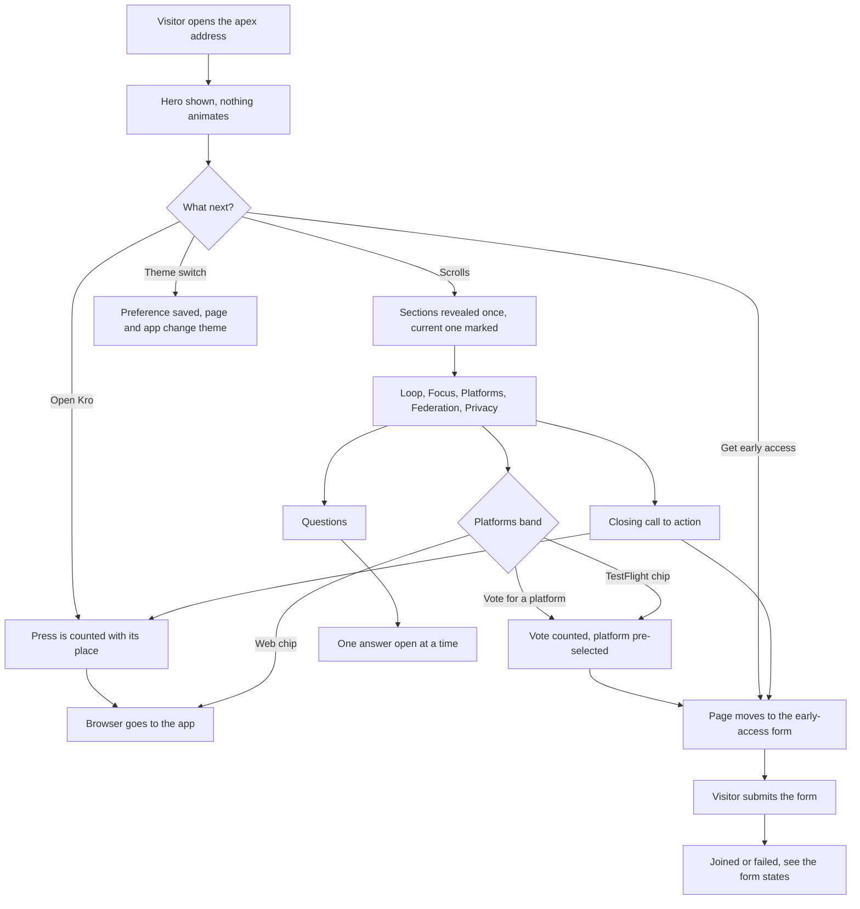
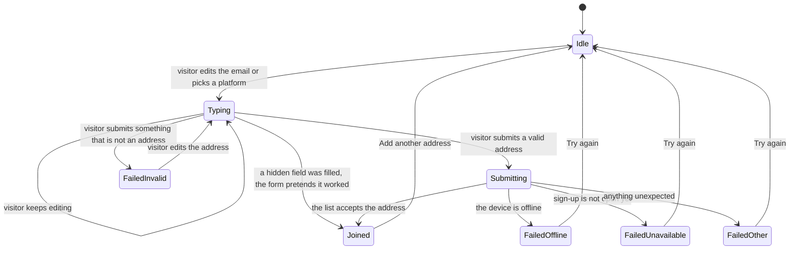

# Landing

## Purpose

The landing page is the public front door of Kro. It tells a first-time
visitor, in one calm scroll, what Kro is — a personal execution system that
carries a thought from capture to reward — shows the product itself rather
than describing it, says plainly which platforms exist today, and offers two
doors: open the web app now, or ask to be written to when another platform is
ready. It makes no claim it cannot back: no counts, ratings or testimonials,
and no promise about what is not built.

## Feature flag

- Name: `landingPage`
- Default state: disabled in the status-quo set (a dark launch); enabled in
  the web product's live build.
- The flag is the kill switch for the whole surface and its early-access
  sign-up: with it off, the front door redirects into the app and the sign-up
  route answers "not open". The web build reads it once, at build time; a
  Debug override inside the running app does not reach the front door.

## Entry points

- The apex address of the site (the root path).
- The hub link — the "Open Kro" and "Open Kro for Web" buttons — which leads
  to the app itself (its My Day destination), on the app's own address.
- Section anchors: the loop, focus, platforms, federation, privacy, early
  access and the questions each have a stable address fragment, and the
  navigation bar and footer link to them.

## Core concepts

- **The loop** — Capture, Triage, Plan, Do, Earn: the five steps the page
  walks through, in that order.
- **Endeavor** — anything worth a person's time: a task, an event or a habit.
- **Section** — one full-width band of the page; the one crossing the middle
  of the screen is the "current" one and is marked in the navigation.
- **Platform status** — live (the web), early access on TestFlight (iPhone,
  iPad, Mac, Apple Watch), in progress (Android) or coming (Windows).
- **Vote** — a visitor's signal that a not-yet-available platform should come
  sooner. A vote is an anonymous count; it does not collect an address.
- **Early access request** — an email address plus the platform a visitor
  wants to hear about. Sending it stores the address and the platform, which
  part of the page it came from and the time, on the sign-up list the
  maintainer runs; a notice under the field says so and names the address to
  write to for removal. The sign-up stays closed until that address is
  configured, so nothing is collected without a way to be removed. The request leaves only from the site's own pages; a slow or
  absent list shows the "not open yet" message. Nothing else on the page asks
  for anything; the analytics count visits and events without a name or an
  address (see *Interactions*).
- **Honeypot** — a form field no person can see; a bot that fills it gets
  exactly the answer a real request would have got and nothing is stored.
- **Theme** — light or dark. The toggle writes the same appearance preference
  the app's own Settings write, so the two never disagree.

## User flows

1. **First visit.** A visitor opens the apex address. The page shows the hero
   at once, without animating it. As they scroll, each section is revealed
   once and the navigation marks the current one. Each section is counted the
   first time it is seen.
2. **Open the hub.** A visitor presses "Open Kro" in the bar, "Open Kro for
   Web" in the hero, in the Platforms band, in the closing call to action or
   on the success card. The press is counted with where it happened, and the
   browser goes to the app.
3. **Early access, happy path.** A visitor presses "Get early access" (or a
   TestFlight platform chip, which pre-selects that platform and moves them to
   the form), types an email address, keeps or changes the platform and
   submits. While the request is in flight the button is disabled and shows
   progress. On success the form is replaced by a card saying "You're on the
   list" for that platform, with a link to open Kro for Web and a way to add
   another address.
4. **Invalid email.** The address is checked when the field is left and again
   on submit. An address that does not look like one shows a message under
   the field; nothing is sent. Typing again clears it.
5. **Already joined.** The list already holds the address. The visitor sees
   the same success card as a new sign-up: the page never reveals whether an
   address is on the list, so nobody can probe it with someone else's.
6. **Offline.** If the device is offline the visitor is told, the address
   they typed is kept, and "Try again" returns them to the form.
7. **Service unavailable.** If sign-up is not open on this site yet, the
   visitor is told so and may try again later; the typed address is kept.
8. **Vote for a platform.** In the Platforms band a visitor presses "Vote for
   Android" or "Vote for Windows". The vote is counted, that platform is
   pre-selected in the early-access form, and the page moves to the form with
   the email field ready.
9. **Toggle the theme.** A visitor presses the sun/moon switch. The page and
   the app switch between light and dark, the choice is remembered on the
   device, and it carries into the app.
10. **FAQ.** A visitor opens one of six questions. One answer is open at a
    time; opening another closes the first. Each opening is counted by the
    question's position, never its text.
11. **Keyboard only.** Every control — the navigation, the buttons, the
    platform choices, the form and the questions — can be reached and used
    without a pointer. A skip link jumps past the bar to the main content.

## States

- **Page at rest** — first paint: hero visible, no section marked current, no
  question open, light or dark as the device or the saved preference says.
- **Mid-scroll** — a section is current; sections already seen are
  remembered so they are counted once; one question may be open.
- **Menu open (small screens)** — the bar's menu lists the sections and the
  call to action.
- **Early-access form: idle** — an empty form, iPhone chosen.
- **Early-access form: typing** — the address and platform filled in; an
  address that was left and does not look right shows a message.
- **Early-access form: submitting** — the button is disabled and shows
  progress; a second press does nothing.
- **Early-access form: joined** — a success card for the chosen platform.
- **Early-access form: failed** — one of four messages: not a valid address,
  offline, sign-up not open yet, or something went wrong. Every one can be
  retried.

## Interactions with other features

- **Appearance (Settings)** — the theme switch writes the saved appearance
  preference and applies it, exactly as the Appearance pane does. The app's
  single theme owner then follows the preference, so the page never fights it.
  The page reads the theme when it opens and after each press of the switch;
  a change made from another tab shows on the next visit.
- **Early access** — the form is its own feature. It checks the address
  itself, sends the request through the site's own sign-up route, and never
  holds a secret on the visitor's side. The platform picker and the vote
  buttons hand it the chosen platform as a request it reads for itself; the
  page never writes the form's state.
- **Analytics** — cookieless counts. A visit is an anonymous, rotating hash
  of the site, the network address and the browser, never a name or an
  address; each event carries the page, the browser's size and language —
  never the words a visitor typed, never the email. Query strings are never
  sent.

| What the visitor does | What is counted |
| --- | --- |
| Opens the page | One page view, with the path |
| Scrolls a section into view | The section's name, once per section |
| Presses an Open Kro button | Where the button was (bar, hero, platforms, closing, success card) |
| Presses a Get early access button or a TestFlight chip | Where it was |
| Submits the early-access form | The platform and that it came from the landing page |
| Joins successfully | The platform, and whether a queue position came back |
| The sign-up fails | The kind of failure only |
| Votes for a platform | The platform |
| Opens a question | Its position in the list |
| Follows an outside link | The destination's host only |
| Uses the theme switch | The theme chosen |
| Opens the menu on a small screen | That it was opened |

## Out of scope

- Accounts, sign-in and payment: the page collects an email for early access
  and nothing else.
- Any figure about how many people use or are waiting for Kro.
- Third-party logos or endorsements.
- A blog, a changelog or localized copy (the page is English only for now).
- Showing real user data: every screenshot is a mock-fixture render.
- Proving the visitor owns the address (double opt-in) and durable rate
  limiting of the sign-up: tracked in issue #104 of this repository.

## Open questions

- Pricing: the "Is Kro free?" answer says the web app is open to use and that
  other platforms have no announced pricing. Owner: product, to confirm the
  wording before the flag goes on. Opened 2026-10-12.
- Screenshots ship as WebP only, with no PNG fallback inside a device frame.
  If an older browser must be supported, the frame primitive needs a picture
  element and the masters come back. Owner: design system. Opened 2026-10-12.
- The `www` host: today it serves the app, indexable, like any unconfigured
  alias; whether it redirects to the apex is a hosting decision. Owner:
  maintainer. Opened 2026-10-13.
- A contact mailbox for removal requests: the deployment value the notice
  shows, and the sign-up requires, is the maintainer's to create and set.
  Owner: maintainer. Opened 2026-10-13.
- The mobile menu's open state is read from the press on its button; closing
  it with the Escape key cannot be seen, so the remembered state self-corrects
  on the next link press. Owner: design system, if the bar should report
  closing. Opened 2026-10-12.
- Whether a TestFlight platform should also take votes. Today only the
  not-yet-built platforms do. Owner: product. Opened 2026-10-12.

## Diagrams

### Page journey

### Early-access form

